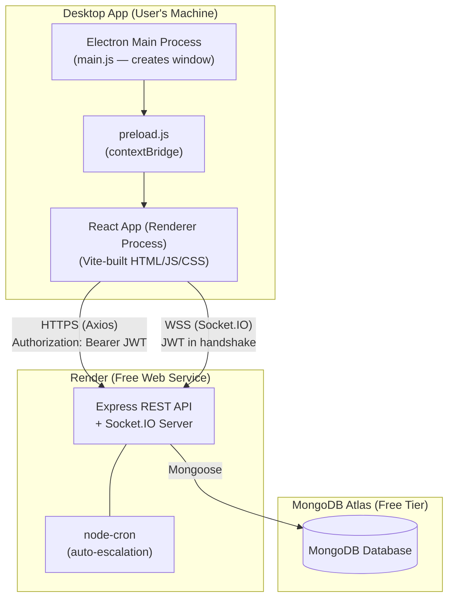
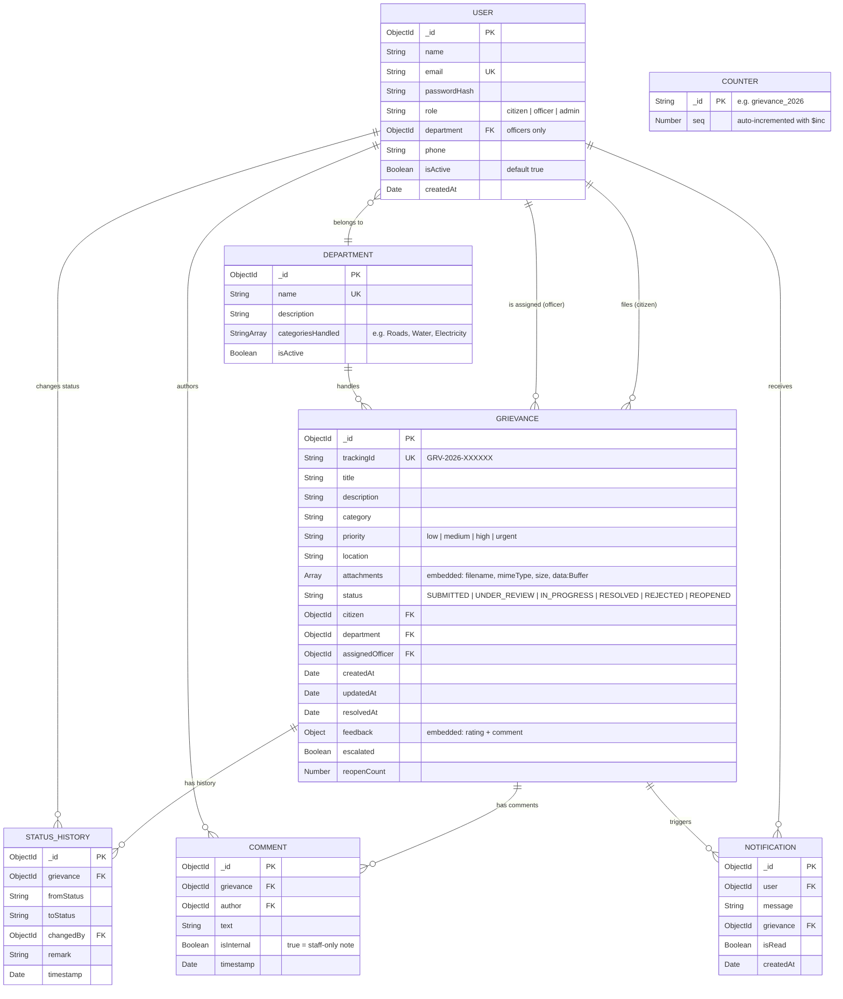
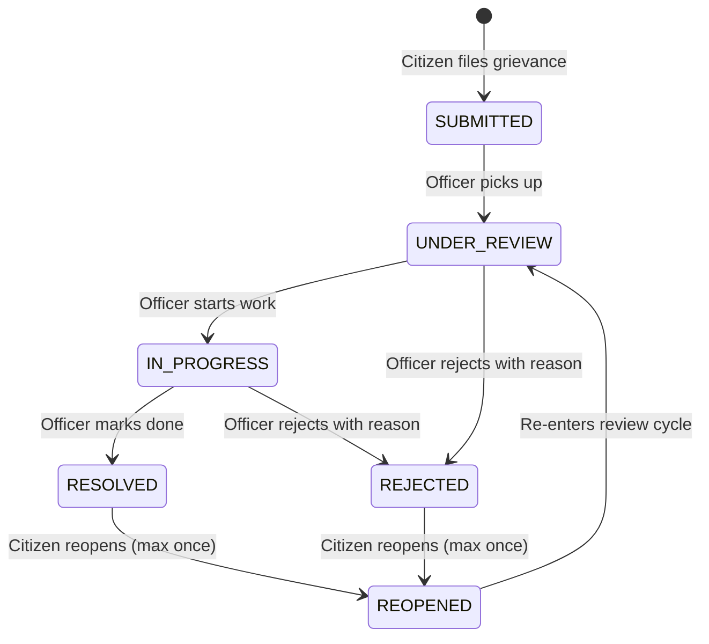

# 🏛️ Public Grievance Tracking System

> A full-stack desktop application for citizens to file, track, and resolve public grievances — built with React, Electron, Node.js, and MongoDB.

---

## 📋 Table of Contents

- [Problem Statement](#-problem-statement)
- [Features](#-features)
- [Architecture](#-architecture)
- [Tech Stack](#-tech-stack)
- [Database Schema](#-database-schema)
- [API Endpoints](#-api-endpoints)
- [Status Workflow](#-status-workflow)
- [Folder Structure](#-folder-structure)
- [Setup & Run](#-setup--run)
- [Build Installers](#-build-installers-exe--dmg)
- [Deployment](#-deployment)
- [Security](#-security)
- [Testing](#-testing)
- [Future Enhancements](#-future-enhancements)
- [Screenshots](#-screenshots)
- [License](#-license)

---

## 🔍 Problem Statement

Citizens across municipalities face a fragmented, opaque process when reporting civic issues such as potholes, water-supply failures, garbage pile-ups, or electricity outages. Complaints are lost in manual registers, there is no way to track progress, and departments lack accountability metrics.

**This system solves that by providing:**

- A single desktop application where citizens file complaints and receive a unique tracking ID.
- An officer-facing dashboard scoped by department for structured resolution.
- An admin panel with analytics, audit trails, and auto-escalation of overdue grievances.
- Real-time notifications so citizens know the moment their grievance status changes.
- A complete, auditable history of every action taken on every grievance.

---

## ✨ Features

### Citizen

- Register and log in with email/password; edit profile
- File a grievance with title, description, category, location, priority, and up to 2 image attachments (JPG/PNG, max 1 MB each)
- Receive a unique tracking ID (e.g., `GRV-2026-000123`)
- View "My Grievances" list with filters (status, category, date) and pagination
- Grievance detail page with a full status timeline
- Add follow-up comments to a grievance
- Reopen a resolved or rejected grievance (once)
- Rate and review the resolution after closure
- Receive real-time notifications when status changes

### Officer

- Department-scoped dashboard showing only relevant grievances
- Filter and sort grievances by status, priority, and date
- Update grievance status with a mandatory remark (logged to audit trail)
- Add internal notes visible only to staff (officers and admins)

### Admin

- Full CRUD for departments and officer accounts
- Assign or reassign grievances to any department or officer
- Analytics dashboard: counts by category/status/department, average resolution time, overdue count
- View the system-wide audit log of all status changes
- Receive alerts when the auto-escalation cron flags overdue grievances

### System

- Enforced status workflow with a backend state machine — invalid transitions are rejected
- Auto-escalation: a `node-cron` scheduled job flags grievances unresolved for N days and notifies admins (see [Known Limitations](#known-limitations) for the Render free-tier caveat)
- Every status change is recorded in a `StatusHistory` audit trail
- Persistent notifications stored in DB (accessible even if the user was offline)
- Department routing: a new grievance is automatically routed to the department whose `categoriesHandled` includes the selected category

---

## 🏗 Architecture

The system follows a **three-tier client-server architecture**. The Electron desktop app is a thin shell — it contains **no backend code** and communicates exclusively with the hosted API over HTTPS.



### Tier Breakdown

| Tier | Component | Responsibility |
|------|-----------|----------------|
| **Presentation** | React app inside Electron (renderer process) | UI rendering, form handling, API calls, real-time event listeners |
| **Application** | Express + Socket.IO on Render | Business logic, authentication, authorization, validation, notifications, cron jobs |
| **Data** | MongoDB Atlas (free tier) | Persistent storage of all documents (users, grievances, history, notifications, image attachments) |

Render provides HTTPS and WebSocket (WSS) support automatically — no reverse proxy or SSL configuration is needed. The backend is a single Node.js process.

### Electron: Main vs Renderer Process

| Process | Runtime | Role |
|---------|---------|------|
| **Main** (`main.js`) | Node.js | Creates the `BrowserWindow`, handles OS-level events (app lifecycle, menus, tray). Does NOT run business logic. |
| **Renderer** | Chromium | Runs the React app. This is what the user sees and interacts with. |
| **Preload** (`preload.js`) | Bridged | Uses `contextBridge` to safely expose a minimal API (e.g., platform info) from Node.js to the renderer. |

**`contextIsolation` is enabled** to prevent the renderer from accessing Node.js APIs directly. This protects against XSS attacks — even if malicious script runs in the renderer, it cannot read/write the user's filesystem or execute shell commands.

### Routing in Electron

The React app uses **`HashRouter`** (not `BrowserRouter`) and Vite is configured with `base: './'`. This is required because Electron loads the production build via the `file://` protocol, which does not support HTML5 `pushState` routing. `HashRouter` uses `#/path` URLs that work with any protocol.

```js
// vite.config.js
export default defineConfig({
  base: './',
  // ...
});
```

---

## ⚙️ Tech Stack

| Layer | Technology | Why This Choice |
|-------|------------|-----------------|
| Frontend | **React + Vite** (latest stable) | Component-based UI with fast HMR; Vite is significantly faster than CRA for dev and builds |
| Routing | **React Router v6** (`HashRouter`) | Declarative client-side routing with role-based protected routes; `HashRouter` required for Electron `file://` |
| HTTP Client | **Axios** | Promise-based, supports interceptors for attaching JWT and handling errors globally |
| Styling | **Tailwind CSS** (v4, or plain CSS) | Set up with `@tailwindcss/vite` plugin and `@import "tailwindcss";` in main CSS (no config file needed); rapid utility-first UI |
| Desktop Shell | **Electron + electron-builder** | Wraps the React SPA into a native desktop app (.exe, .dmg) with OS integration |
| Backend | **Node.js 20+ / Express** | Non-blocking I/O, massive npm ecosystem, same language as frontend |
| Database | **MongoDB + Mongoose** | Flexible document model fits the varied grievance data; Mongoose provides schema validation and query building |
| DB Hosting | **MongoDB Atlas** (free tier) | Managed cloud database with free tier (512 MB) and built-in monitoring |
| Backend Hosting | **Render** (free tier) | Zero-config HTTPS, WebSocket support, GitHub auto-deploy, free web service tier |
| Auth | **JWT + bcrypt** | Stateless authentication (no server-side sessions); bcrypt for secure password hashing with salt. JWT sent in `Authorization: Bearer` header, not cookies |
| Real-time | **Socket.IO** | Bi-directional WebSocket communication with automatic fallback to long-polling; JWT verified in the handshake |
| File Uploads | **Multer** (`memoryStorage`) | Multipart/form-data middleware; images stored as Buffers directly in MongoDB (no external storage needed for this demo) |
| Validation | **Joi** (or express-validator) | Declarative schema validation for all API inputs — prevents injection and malformed data |
| Scheduling | **node-cron** | Lightweight in-process cron for auto-escalation job; no external scheduler needed |

---

## 🗄 Database Schema

### Entity-Relationship Diagram



### Design Decisions

| Decision | Rationale |
|----------|-----------|
| **StatusHistory as separate collection** (referenced) | Grows unboundedly per grievance; admin needs to query across all grievances for the audit log |
| **Comments as separate collection** (referenced) | Grows unboundedly; may need independent queries (e.g., "all internal notes for a department") |
| **Feedback embedded in Grievance** | 1:1 relationship, small and fixed (rating + comment), always read with the grievance |
| **Attachments embedded in Grievance (with Buffer)** | Max 2 images × 1 MB = 2 MB per grievance, well within MongoDB's 16 MB document limit. No external storage service needed for this demo project. **⚠️ This approach is chosen only because this is a small demo project with limited users. Production systems should use cloud object storage to avoid bloating the database.** |
| **User.department as reference** | Many officers share one department; avoids duplicate data and inconsistency |
| **Counter collection for tracking IDs** | Atomic `findOneAndUpdate` with `$inc` prevents race conditions when two citizens submit simultaneously. Key is `grievance_YYYY` for automatic yearly reset. |
| **User.isActive field** | Allows admins to deactivate accounts without deleting data; auth middleware rejects deactivated users even if their JWT is still valid |

### Attachment Handling

Images are stored directly in MongoDB inside the Grievance document:

```js
// Schema shape for each attachment
{
  filename: String,     // "pothole.jpg"
  mimeType: String,     // "image/jpeg"
  size: Number,         // bytes
  data: Buffer          // raw image bytes
}
```

**Important:** List and detail endpoints **never return image data**. They use `.select('-attachments.data')` and return only metadata (filename, mimeType, size). A separate `GET /grievances/:id/attachments/:index` endpoint streams the image with the correct `Content-Type` header.

#### Displaying Attachments in the UI

Because attachments are served from a JWT-protected endpoint, standard `` tags **cannot be used** directly (standard HTML image tags cannot send the `Authorization: Bearer <token>` header).

The frontend solves this using the `AttachmentViewer` component:
1. It requests the image via Axios with `responseType: 'blob'` and the Bearer token in the `Authorization` header.
2. It converts the returned binary blob into an in-memory object URL using `URL.createObjectURL(blob)`.
3. It renders ``.
4. On component unmount or when the image changes, it calls `URL.revokeObjectURL(objectUrl)` to prevent memory leaks.

### Tracking ID Generation (Atomic)

```js
// Uses a Counter collection with findOneAndUpdate + $inc
const year = new Date().getFullYear();
const counter = await Counter.findOneAndUpdate(
  { _id: `grievance_${year}` },
  { $inc: { seq: 1 } },
  { new: true, upsert: true }
);
const trackingId = `GRV-${year}-${String(counter.seq).padStart(6, '0')}`;
// → "GRV-2026-000001", "GRV-2026-000002", ...
// Resets automatically each year because the key changes
```

### Indexes

| Collection | Field(s) | Type | Purpose |
|------------|----------|------|---------|
| User | `email` | Unique | Fast login lookup |
| Grievance | `trackingId` | Unique | Citizen search by tracking ID |
| Grievance | `status` | Regular | Officer dashboard filtering |
| Grievance | `department, status` | Compound | Department-scoped dashboard queries |
| Grievance | `citizen` | Regular | "My Grievances" page |
| StatusHistory | `grievance` | Regular | Fetching timeline for a grievance |
| Notification | `user, isRead` | Compound | "My unread notifications" query |

---

## 🔌 API Endpoints

Base URL: `/api/v1`

Authentication for all protected endpoints: `Authorization: Bearer <JWT>` header. JWT is never sent via cookies.

### Health Check

| Method | Endpoint | Access | Description |
|--------|----------|--------|-------------|
| GET | `/health` | Public | Returns `{ status: "ok", timestamp }`. Used as Render health-check path. |

### Authentication

| Method | Endpoint | Access | Description |
|--------|----------|--------|-------------|
| POST | `/auth/register` | Public | Register a new citizen account |
| POST | `/auth/login` | Public | Login and receive JWT |
| GET | `/auth/me` | Authenticated | Get current user profile |
| PATCH | `/auth/me` | Authenticated | Update own profile (name, phone, password) |

### Categories

| Method | Endpoint | Access | Description |
|--------|----------|--------|-------------|
| GET | `/categories` | Authenticated | List all categories from active departments' `categoriesHandled` (for the grievance form dropdown) |

### Grievances

| Method | Endpoint | Access | Description |
|--------|----------|--------|-------------|
| POST | `/grievances` | Citizen | File a new grievance (multipart, max 2 images). Department auto-assigned from category via `Department.categoriesHandled`. |
| GET | `/grievances` | Authenticated | List grievances (role-scoped, paginated, filterable). Citizens see only their own. Officers see only their department. Admins see all. Excludes `attachments.data`. |
| GET | `/grievances/:id` | Authenticated | Get grievance details with populated references. Access rules enforced per role. Excludes `attachments.data`. |
| GET | `/grievances/track/:trackingId` | Authenticated | Look up grievance by tracking ID. Citizens can only look up their own grievances. Excludes `attachments.data`. |
| GET | `/grievances/:id/attachments/:index` | Authenticated | Stream a specific attachment image with correct `Content-Type`. Same access rules as the grievance. |
| PATCH | `/grievances/:id/status` | Officer, Admin | Update status (validates transition, requires remark). Creates StatusHistory entry. Emits Socket.IO notification. |
| PATCH | `/grievances/:id/assign` | Admin | Assign/reassign to a department or officer |
| POST | `/grievances/:id/comments` | Authenticated | Add a comment. Officers/admins can set `isInternal: true`. Internal comments are never returned to citizens. |
| POST | `/grievances/:id/feedback` | Citizen | Rate and review a resolved grievance |
| POST | `/grievances/:id/reopen` | Citizen | Reopen a resolved/rejected grievance (max once per grievance) |

### Departments (Admin Only)

| Method | Endpoint | Description |
|--------|----------|-------------|
| GET | `/departments` | List all departments |
| POST | `/departments` | Create a new department |
| PATCH | `/departments/:id` | Update department details |
| DELETE | `/departments/:id` | Soft-delete / deactivate a department |

### Users (Admin Only)

| Method | Endpoint | Description |
|--------|----------|-------------|
| GET | `/users` | List all users (filterable by role) |
| POST | `/users` | Create an officer or admin account |
| PATCH | `/users/:id` | Update user details, role, or `isActive` status |
| DELETE | `/users/:id` | Deactivate a user account (sets `isActive: false`) |

### Analytics (Admin Only)

| Method | Endpoint | Description |
|--------|----------|-------------|
| GET | `/analytics/summary` | Total counts by status, overdue count, escalated count |
| GET | `/analytics/by-category` | Grievance counts grouped by category |
| GET | `/analytics/resolution-time` | Average resolution time by department |

### Audit Log (Admin Only)

| Method | Endpoint | Description |
|--------|----------|-------------|
| GET | `/audit-logs` | Paginated list of all StatusHistory entries with populated user and grievance references |

### Notifications

| Method | Endpoint | Access | Description |
|--------|----------|--------|-------------|
| GET | `/notifications` | Authenticated | List user's notifications (paginated, newest first) |
| PATCH | `/notifications/:id/read` | Authenticated | Mark a notification as read |

### Escalation Job (Protected)

| Method | Endpoint | Access | Description |
|--------|----------|--------|-------------|
| POST | `/jobs/escalate` | Admin JWT or `x-cron-secret` | Manually trigger the auto-escalation job. Authorized by either an admin Bearer token or an `x-cron-secret` header matching `CRON_SECRET`. Designed for external cron pingers (e.g., cron-job.org) to handle scheduled runs despite Render free-tier sleep. |

### Access Control Rules

| Role | Grievances Visible | Can Update Status | Can See Internal Comments |
|------|--------------------|-------------------|--------------------------|
| **Citizen** | Only their own (including via `/track/:trackingId`) | No | No — internal comments are filtered out |
| **Officer** | Only their department's grievances | Yes — with mandatory remark | Yes |
| **Admin** | All grievances | Yes — with mandatory remark | Yes |

### Standard Response Format

```json
// ✅ Success
{
  "success": true,
  "data": { },
  "message": "Grievance created successfully",
  "pagination": {
    "page": 1,
    "limit": 10,
    "total": 47,
    "pages": 5
  }
}

// ❌ Error
{
  "success": false,
  "error": {
    "code": "VALIDATION_ERROR",
    "message": "Title must be between 5 and 200 characters",
    "details": [
      { "field": "title", "message": "Must be 5-200 characters" }
    ]
  }
}
```

---

## 🔄 Status Workflow

Every grievance follows a strict state machine. The backend enforces valid transitions — invalid ones return `400 Bad Request`.



### Transition Rules

| From | Allowed To | Who Can Trigger |
|------|-----------|-----------------|
| `SUBMITTED` | `UNDER_REVIEW` | Officer, Admin |
| `UNDER_REVIEW` | `IN_PROGRESS`, `REJECTED` | Officer, Admin |
| `IN_PROGRESS` | `RESOLVED`, `REJECTED` | Officer, Admin |
| `RESOLVED` | `REOPENED` | Citizen (once) |
| `REJECTED` | `REOPENED` | Citizen (once) |
| `REOPENED` | `UNDER_REVIEW` | Officer, Admin |

### Backend Enforcement

```javascript
const VALID_TRANSITIONS = {
  SUBMITTED:    ['UNDER_REVIEW'],
  UNDER_REVIEW: ['IN_PROGRESS', 'REJECTED'],
  IN_PROGRESS:  ['RESOLVED', 'REJECTED'],
  RESOLVED:     ['REOPENED'],
  REJECTED:     ['REOPENED'],
  REOPENED:     ['UNDER_REVIEW'],
};

function canTransition(currentStatus, newStatus) {
  return VALID_TRANSITIONS[currentStatus]?.includes(newStatus) ?? false;
}
```

Every transition creates a `StatusHistory` entry with the previous status, new status, who changed it, a mandatory remark, and a timestamp.

---

## 📁 Folder Structure

```
grievance-system/
├── server/                          # Backend (Node.js + Express)
│   ├── config/
│   │   └── db.js                    # MongoDB connection setup
│   ├── models/
│   │   ├── User.js
│   │   ├── Department.js
│   │   ├── Grievance.js
│   │   ├── StatusHistory.js
│   │   ├── Comment.js
│   │   ├── Notification.js
│   │   └── Counter.js               # Atomic tracking ID counter
│   ├── controllers/
│   │   ├── authController.js
│   │   ├── grievanceController.js
│   │   ├── departmentController.js
│   │   ├── userController.js
│   │   ├── categoryController.js     # GET /categories
│   │   ├── analyticsController.js
│   │   ├── auditLogController.js     # GET /audit-logs
│   │   ├── notificationController.js
│   │   └── jobController.js          # POST /jobs/escalate
│   ├── routes/
│   │   ├── healthRoutes.js           # GET /health
│   │   ├── authRoutes.js
│   │   ├── grievanceRoutes.js
│   │   ├── departmentRoutes.js
│   │   ├── userRoutes.js
│   │   ├── categoryRoutes.js
│   │   ├── analyticsRoutes.js
│   │   ├── auditLogRoutes.js
│   │   ├── notificationRoutes.js
│   │   └── jobRoutes.js              # POST /jobs/escalate
│   ├── middleware/
│   │   ├── auth.js                  # JWT verification; rejects isActive === false
│   │   ├── authorize.js             # Role-based access control
│   │   ├── validate.js              # Joi schema validation
│   │   ├── upload.js                # Multer memoryStorage config (2 files, 1 MB, jpg/png)
│   │   ├── rateLimiter.js           # 20 req/15 min on login/register only; bypassed in dev
│   │   └── errorHandler.js          # Global error handler
│   ├── services/
│   │   ├── notificationService.js   # Socket.IO + DB notification logic
│   │   └── trackingIdService.js     # Atomic tracking ID generation via Counter
│   ├── jobs/
│   │   └── escalation.js           # node-cron auto-escalation job (0 */6 * * *)
│   ├── utils/
│   │   ├── constants.js             # Status enums, transition map
│   │   └── apiResponse.js           # Standardized response helpers
│   ├── validations/
│   │   ├── authValidation.js
│   │   └── grievanceValidation.js
│   ├── tests/
│   │   ├── setup.js                 # Test DB connection, cleanup
│   │   ├── auth.test.js
│   │   └── grievance.test.js
│   ├── seed.js                      # npm run seed — dev data (do not run in prod!)
│   ├── app.js                       # Express app setup (middleware, routes, trust proxy)
│   ├── server.js                    # HTTP server + Socket.IO bootstrap
│   ├── package.json
│   └── .env.example
│
├── client/                          # Frontend (React + Vite)
│   ├── public/
│   ├── src/
│   │   ├── components/
│   │   │   ├── common/              # Button, Modal, Toast, Pagination, LoadingScreen, etc.
│   │   │   ├── grievance/           # GrievanceCard, StatusTimeline, AttachmentViewer (Axios blob + object URL), etc.
│   │   │   ├── dashboard/           # StatCard, ChartWidget, etc.
│   │   │   └── layout/              # Navbar, Sidebar, Footer
│   │   ├── pages/
│   │   │   ├── auth/                # Login, Register
│   │   │   ├── citizen/             # FileGrievance, MyGrievances, GrievanceDetail
│   │   │   ├── officer/             # OfficerDashboard, UpdateGrievance
│   │   │   └── admin/               # AdminDashboard, ManageDepartments, ManageUsers, Analytics, AuditLog
│   │   ├── context/
│   │   │   ├── AuthContext.jsx       # Auth state, login/logout, JWT management
│   │   │   └── SocketContext.jsx     # Socket.IO connection with JWT in handshake
│   │   ├── services/
│   │   │   └── api.js               # Axios instance with interceptors and Bearer token
│   │   ├── hooks/
│   │   │   ├── useAuth.js
│   │   │   └── useGrievances.js
│   │   ├── utils/
│   │   │   ├── constants.js
│   │   │   └── helpers.js
│   │   ├── App.jsx                  # HashRouter, route definitions with role guards
│   │   └── main.jsx                 # React entry point
│   ├── index.html
│   ├── vite.config.js               # base: './' for Electron, @tailwindcss/vite plugin
│   └── package.json
│
├── desktop/                         # Electron shell
│   ├── main.js                      # Main process — creates BrowserWindow
│   ├── preload.js                   # contextBridge — minimal safe API
│   ├── assets/
│   │   ├── icon.ico                 # Windows icon
│   │   ├── icon.icns                # macOS icon
│   │   └── icon.png                 # Fallback / Linux icon
│   ├── electron-builder.yml         # Build config for .exe and .dmg
│   └── package.json                 # scripts: build:win / build:mac with --publish never
│
├── docs/                            # Software Engineering deliverables
│   ├── SRS.md                       # Software Requirements Specification
│   ├── use-case-diagram.png
│   ├── class-diagram.png
│   ├── er-diagram.png
│   ├── dfd-level0.png
│   ├── dfd-level1.png
│   ├── sequence-file-grievance.png
│   ├── sequence-update-status.png
│   ├── test-plan.md
│   └── risk-analysis.md
│
├── .gitignore
└── README.md
```

---

## 🚀 Setup & Run

### Prerequisites

- **Node.js** v20+ and npm
- **MongoDB** (local instance or MongoDB Atlas connection string)
- **Git**

### 1. Clone the Repository

```bash
git clone https://github.com/your-username/grievance-system.git
cd grievance-system
```

### 2. Backend Setup

```bash
cd server
npm install
```

Create a `.env` file in `server/` (see `.env.example`):

```env
PORT=5000
NODE_ENV=development
MONGO_URI=mongodb+srv://<user>:<password>@cluster0.xxxxx.mongodb.net/grievance-system
JWT_SECRET=your_jwt_secret_key_here
JWT_EXPIRE=7d
CORS_ORIGINS=http://localhost:5173
ESCALATION_DAYS=7
CRON_SECRET=your_cron_secret_here
```

Start the server:

```bash
# Development (with nodemon)
npm run dev

# Production
npm start
```

The API will be available at `http://localhost:5000/api/v1`.
Health check: `GET http://localhost:5000/health`.

> **Note:** The server sets `app.set('trust proxy', 1)` because Render (and similar PaaS) sits behind a reverse proxy. This ensures `express-rate-limit` and `req.ip` work correctly.

### 3. Frontend Setup

```bash
cd client
npm install
```

Create a `.env` file in `client/`:

```env
VITE_API_BASE_URL=http://localhost:5000/api/v1
VITE_SOCKET_URL=http://localhost:5000
```

Start the dev server:

```bash
npm run dev
```

The React app will be available at `http://localhost:5173`.

### 4. Desktop (Electron) Setup

```bash
cd desktop
npm install
```

**Dev mode** (loads from Vite dev server — start the client first):

```bash
npm run dev
```

This launches an Electron window pointing at `http://localhost:5173` with hot reload.

### 5. Seed Data (Optional, Dev Only)

```bash
cd server
npm run seed
```

Creates a default admin account (`admin@grievance.local` / `admin123`), sample departments with categories, and test grievances for local development.

> **⚠️ Security Warning:** Do NOT run `npm run seed` against a production database. If it is ever run there by mistake, immediately change the default admin password (`admin123`) via `PATCH /api/v1/auth/me`.

---

## 📦 Build Installers (.exe & .dmg)

### Step 1: Build the React App

Set the production API URL in `client/.env.production`:

```env
VITE_API_BASE_URL=https://your-app.onrender.com/api/v1
VITE_SOCKET_URL=https://your-app.onrender.com
```

```bash
cd client
npm run build    # outputs to client/dist/
```

### Step 2: Copy Build to Desktop

```bash
cp -r client/dist desktop/dist
```

### Step 3: Build the Installer Manually

Installers are built **manually** on their respective host platforms. In `desktop/package.json`, the build scripts include `--publish never` so electron-builder will not attempt to upload to any release server:

```json
// desktop/package.json
{
  "scripts": {
    "dev": "electron .",
    "build:win": "electron-builder --win --publish never",
    "build:mac": "electron-builder --mac --publish never"
  }
}
```

Run the build on the target operating system:

```bash
cd desktop

# On Windows (creates .exe via NSIS installer):
npm run build:win

# On macOS (creates .dmg):
npm run build:mac
```

Output installers are generated in `desktop/release/`.

### electron-builder Configuration

```yaml
# desktop/electron-builder.yml
appId: com.grievance.tracker
productName: Grievance Tracker
directories:
  output: release
files:
  - dist/**/*
  - main.js
  - preload.js
win:
  target: nsis
  icon: assets/icon.ico
mac:
  target: dmg
  icon: assets/icon.icns
nsis:
  oneClick: false
  allowToChangeInstallationDirectory: true
```

### ⚠️ Platform Build Requirements

- **`.dmg` (macOS):** Can only be built on macOS.
- **`.exe` (Windows):** Must be built on a Windows machine (or VM).

### ⚠️ Unsigned Installer Warnings

The built installers are **not code-signed** (code signing certificates require paid developer accounts). Users will see standard security warnings on first launch:

| OS | Warning | How to Open |
|----|---------|-------------|
| **Windows** | SmartScreen: "Windows protected your PC" | Click **"More info"** → **"Run anyway"** |
| **macOS** | Gatekeeper: "App can't be opened because it is from an unidentified developer" | **Right-click** the app → **Open** → click **"Open"** in the confirmation dialog |

---

## ☁️ Deployment

### Backend — Render (Free Tier)

1. Push your code to a GitHub repository.
2. Create a new **Web Service** on [Render](https://render.com) (free tier).
3. Connect your GitHub repo.
4. Configure:
   - **Root directory:** `server`
   - **Build command:** `npm install`
   - **Start command:** `npm start`
   - **Health check path:** `/health`
5. Add environment variables in the Render dashboard:
   ```
   NODE_ENV=production
   MONGO_URI=mongodb+srv://...
   JWT_SECRET=your_production_secret
   JWT_EXPIRE=7d
   CRON_SECRET=your_production_cron_secret
   ESCALATION_DAYS=7
   ```
   > **Note on CORS:** The packaged Electron app sends `Origin: "null"` or `Origin: "file://"` from the `file://` protocol. Both are handled directly in server code. `CORS_ORIGINS` is only needed for dev origins (e.g., `http://localhost:5173`) and may be left unset in Render production.
6. Render will auto-deploy on every push to `main` and provide an HTTPS URL (e.g., `https://your-app.onrender.com`).

### Database — MongoDB Atlas (Free Tier)

1. Create a free M0 cluster at [MongoDB Atlas](https://www.mongodb.com/atlas) (512 MB storage).
2. Create a database user with read/write access.
3. In **Network Access**, allow `0.0.0.0/0` (required for Render, whose IPs are dynamic).
4. Copy the connection string and set it as `MONGO_URI` in Render's env vars.

### Known Limitations

| Limitation | Impact | Workaround |
|------------|--------|------------|
| **Render free tier sleeps after ~15 min of inactivity** | First request after sleep takes 30–60 seconds to cold-start the service | The client app shows a **"Connecting to server…"** loading screen on startup. The first API call (e.g., health check) wakes the service. |
| **`node-cron` does not run while the service sleeps** | The escalation job scheduled for `0 */6 * * *` (every 6 hours) will not fire if the service is asleep | A protected `POST /api/v1/jobs/escalate` endpoint is provided. Register it with an external free pinger like [cron-job.org](https://cron-job.org) set to POST every 6 hours with the `x-cron-secret` header (matching `CRON_SECRET`), which also keeps the service active. |
| **MongoDB Atlas free tier: 512 MB storage** | With images stored in MongoDB, storage fills faster | 2 images × 1 MB × 500 grievances = ~1 GB. For a demo with <200 grievances, this is fine. Monitor usage in the Atlas dashboard. |
| **No code signing** | OS security warnings on install | See [Unsigned Installer Warnings](#%EF%B8%8F-unsigned-installer-warnings) for how to open anyway |

---

## 🔒 Security

| Measure | Implementation | Purpose |
|---------|----------------|---------|
| **Password Hashing** | bcrypt with 10–12 salt rounds | Passwords are never stored in plain text; resistant to rainbow table attacks |
| **JWT Authentication** | Signed tokens with configurable expiry (1–7 days), sent in `Authorization: Bearer` header (not cookies) | Stateless authentication — no session store required. Using headers (not cookies) means CSRF attacks are not applicable. |
| **Active User Check** | Auth middleware checks `isActive === true` after verifying JWT | Deactivated users are rejected immediately even if their JWT has not expired |
| **Role-Based Access Control** | `authorize('admin', 'officer')` middleware | Endpoints are restricted by user role; citizens cannot access officer/admin routes |
| **Input Validation** | Joi schemas on every endpoint | Rejects malformed data, prevents NoSQL injection, enforces field constraints |
| **Input Sanitization** | `express-mongo-sanitize` | Strips `$` and `.` from user input to prevent MongoDB operator injection |
| **Rate Limiting** | `express-rate-limit` on `/auth/login` and `/auth/register` only (20 req/15 min); disabled when `NODE_ENV=development` | Prevents brute-force login and registration abuse without locking out developers during testing/demos. Not applied to `/auth/me`. |
| **Trust Proxy** | `app.set('trust proxy', 1)` | Required on Render so rate limiter reads the real client IP from `X-Forwarded-For`, not the proxy's IP |
| **Security Headers** | Helmet middleware | Sets `X-Frame-Options`, `X-Content-Type-Options`, `Strict-Transport-Security`, CSP, and others |
| **CORS** | Whitelist dev origins + `'null'` and `'file://'` for packaged Electron app | Restricts which origins can call the API (see details below) |
| **Socket.IO Auth** | Handshake verifies JWT, loads user, rejects if `isActive === false`, joins `user:<id>` room | Ensures only active, authenticated users connect; notifications are emitted only to the intended user's room |
| **File Upload Limits** | Multer `memoryStorage`: max 2 files, max 1 MB each, only `image/jpeg` and `image/png` | Prevents storage abuse, blocks non-image and oversized uploads |
| **HTTPS** | Provided automatically by Render | All data in transit is encrypted; no manual SSL/TLS setup needed |

### CORS and Electron — Important Detail

When the React app runs inside Electron in **production** (loaded via the `file://` protocol), the browser sends either the literal string `"null"` or `"file://"` as the `Origin` header (this varies by operating system and Chromium version).

Both must be permitted by CORS in Express and Socket.IO:

```javascript
// server/app.js
const corsOptions = {
  origin: function (origin, callback) {
    const allowed = (process.env.CORS_ORIGINS || '')
      .split(',')
      .map(s => s.trim())
      .filter(Boolean);

    // In dev: origin matches http://localhost:5173
    // In prod (Electron file://): origin is literal string "null" or starts with "file://"
    // Postman / server-to-server: origin is undefined
    const isElectron = origin === 'null' || origin === 'file://' || (origin && origin.startsWith('file://'));

    if (!origin || isElectron || allowed.includes(origin)) {
      callback(null, true);
    } else {
      callback(new Error('Not allowed by CORS'));
    }
  },
  credentials: true,
};

app.use(cors(corsOptions));
```

**Socket.IO must be configured with the exact same CORS rule:**

```javascript
// server/server.js
const io = new Server(httpServer, {
  cors: {
    origin: function (origin, callback) {
      const allowed = (process.env.CORS_ORIGINS || '')
        .split(',')
        .map(s => s.trim())
        .filter(Boolean);
      const isElectron = origin === 'null' || origin === 'file://' || (origin && origin.startsWith('file://'));

      if (!origin || isElectron || allowed.includes(origin)) {
        callback(null, true);
      } else {
        callback(new Error('Not allowed by CORS'));
      }
    },
    credentials: true,
  },
});
```

> **💡 Verifying Packaged Origin:** Once packaged, press `Ctrl+Shift+I` (Windows) or `Cmd+Option+I` (macOS) inside the Electron app to open DevTools. Check **Network → any API request → Request Headers → Origin** to confirm the exact origin header sent by your build.
>
> **Why is allowing `"null"` and `"file://"` origins safe?** Because CORS is not the authentication gate — JWT is. Every protected endpoint requires a valid `Authorization: Bearer <token>` header. Without it, requests are rejected regardless of origin.

### Socket.IO Authentication

The JWT is verified during the WebSocket handshake before any connection is accepted. In addition, the user is checked against the database to ensure their account is active:

```javascript
// server/server.js
io.use(async (socket, next) => {
  const token = socket.handshake.auth.token;
  if (!token) return next(new Error('Authentication required'));
  try {
    const decoded = jwt.verify(token, process.env.JWT_SECRET);
    // Verify user exists and is active (same rule as HTTP auth middleware)
    const user = await User.findById(decoded.id).select('isActive role');
    if (!user || !user.isActive) {
      return next(new Error('Account is inactive or does not exist'));
    }
    socket.user = { id: user._id.toString(), role: user.role };
    next();
  } catch (err) {
    next(new Error('Invalid token'));
  }
});

io.on('connection', (socket) => {
  // Each user joins a private room — notifications are sent only here
  socket.join(`user:${socket.user.id}`);

  // Admins additionally join an admin room for system-wide alerts
  if (socket.user.role === 'admin') {
    socket.join('admins');
  }
});

// Emitting a notification (e.g., from grievanceController after status update)
io.to(`user:${citizenId}`).emit('status-update', {
  trackingId: 'GRV-2026-000042',
  newStatus: 'IN_PROGRESS',
  message: 'Your grievance is now being worked on.',
});
```

---

## 🧪 Testing

### Testing Strategy

| Level | Tool | What is Tested |
|-------|------|----------------|
| **Unit Tests** | Jest | Mongoose model validations, utility functions (tracking ID generation, transition map), service logic |
| **Integration Tests** | Jest + Supertest | API endpoints — request/response cycle with a test database |
| **End-to-End** | Manual / Playwright | Full workflows: citizen files grievance → officer resolves → citizen rates |

### Running Tests

```bash
cd server
npm test                # Run all tests
npm run test:coverage   # Run with coverage report
```

### Sample Test Cases

| ID | Category | Test Case | Expected Result |
|----|----------|-----------|-----------------|
| TC-01 | Auth | Register with valid data | 201, user created, JWT returned |
| TC-02 | Auth | Register with duplicate email | 409, "Email already registered" |
| TC-03 | Auth | Login with wrong password | 401, "Invalid credentials" |
| TC-04 | Auth | Login as deactivated user (`isActive: false`) | 401, "Account deactivated" |
| TC-05 | Grievance | Citizen files grievance with all fields and 1 image | 201, tracking ID generated, status = SUBMITTED, department auto-assigned from category |
| TC-06 | Grievance | File grievance without JWT | 401, "Not authenticated" |
| TC-07 | Grievance | Officer updates status SUBMITTED → UNDER_REVIEW | 200, StatusHistory entry created, Socket.IO notification emitted |
| TC-08 | Grievance | Officer attempts SUBMITTED → RESOLVED (invalid) | 400, "Invalid status transition" |
| TC-09 | Grievance | Citizen reopens a resolved grievance | 200, status = REOPENED, reopenCount = 1 |
| TC-10 | Grievance | Citizen reopens a second time | 403, "Grievance can only be reopened once" |
| TC-11 | Upload | Upload image larger than 1 MB | 400, "File size exceeds 1 MB limit" |
| TC-12 | Upload | Upload a .gif file | 400, "Only JPG and PNG files are allowed" |
| TC-13 | Upload | Upload 3 images at once | 400, "Maximum 2 attachments allowed" |
| TC-14 | Access | Citizen tries to access admin analytics | 403, "Not authorized" |
| TC-15 | Access | Citizen tries to view another citizen's grievance | 404 or 403, grievance not returned |
| TC-16 | Access | Citizen requests grievance detail — response must NOT contain `attachments.data` | 200, attachments array contains only `filename`, `mimeType`, `size` |
| TC-17 | Attachment | `GET /grievances/:id/attachments/0` with valid JWT | 200, correct `Content-Type`, image binary streamed |
| TC-18 | Escalation | Grievance unresolved for 7+ days | Cron flags `escalated: true`, admin notified |
| TC-19 | Real-time | Officer updates status | Citizen receives Socket.IO `status-update` event in real-time |

---

## 🔮 Future Enhancements

| Enhancement | Description |
|-------------|-------------|
| **Email / SMS Notifications** | Send email (Nodemailer) or SMS (Twilio) alerts in addition to in-app notifications |
| **Map Integration** | Use Leaflet or Google Maps to let citizens pin grievance locations and show a heat map of complaints |
| **Object Storage for Attachments** | Migrate image storage from MongoDB to AWS S3 or Cloudinary for production scalability |
| **Multi-language Support** | i18n with `react-i18next` for Hindi, regional languages |
| **Mobile App** | React Native app reusing the same backend API |
| **AI Categorization** | Use a text classifier to auto-suggest grievance category from the description |
| **SLA Tracking** | Define per-category SLAs (e.g., "Roads: resolve within 7 days") with dashboards showing compliance |
| **Bulk Import/Export** | Admin can export grievance data to CSV/Excel for reporting |
| **OAuth Login** | Add Google / DigiLocker login alongside email/password |
| **Offline Support** | Cache grievances locally in Electron with sync on reconnect |
| **Auto-Update** | Use `electron-updater` to push desktop app updates automatically |
| **Docker + NGINX** | Containerize the backend behind NGINX for production deployments with load balancing and custom SSL |

---

## 📸 Screenshots

> _Screenshots will be added after the UI is built._

| Screen | Description |
|--------|-------------|
| Login Page |  |
| Citizen Dashboard |  |
| File Grievance Form |  |
| Grievance Detail + Timeline |  |
| Officer Dashboard |  |
| Admin Analytics |  |

---

## 📄 License

This project is licensed under the [MIT License](LICENSE).

```
MIT License

Copyright (c) 2026

Permission is hereby granted, free of charge, to any person obtaining a copy
of this software and associated documentation files (the "Software"), to deal
in the Software without restriction, including without limitation the rights
to use, copy, modify, merge, publish, distribute, sublicense, and/or sell
copies of the Software, and to permit persons to whom the Software is
furnished to do so, subject to the following conditions:

The above copyright notice and this permission notice shall be included in all
copies or substantial portions of the Software.

THE SOFTWARE IS PROVIDED "AS IS", WITHOUT WARRANTY OF ANY KIND, EXPRESS OR
IMPLIED, INCLUDING BUT NOT LIMITED TO THE WARRANTIES OF MERCHANTABILITY,
FITNESS FOR A PARTICULAR PURPOSE AND NONINFRINGEMENT. IN NO EVENT SHALL THE
AUTHORS OR COPYRIGHT HOLDERS BE LIABLE FOR ANY CLAIM, DAMAGES OR OTHER
LIABILITY, WHETHER IN AN ACTION OF CONTRACT, TORT OR OTHERWISE, ARISING FROM,
OUT OF OR IN CONNECTION WITH THE SOFTWARE OR THE USE OR OTHER DEALINGS IN THE
SOFTWARE.
```

---

<p align="center">
  Built with ❤️ for Software Engineering coursework
</p>
