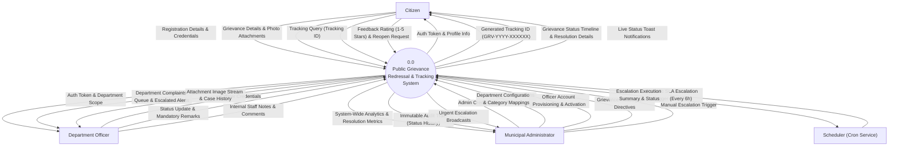
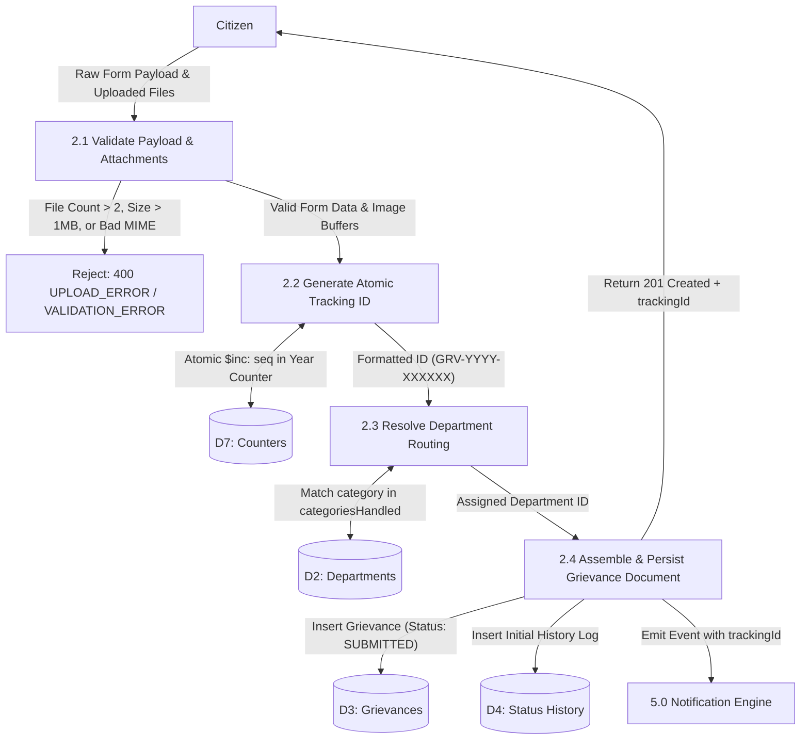
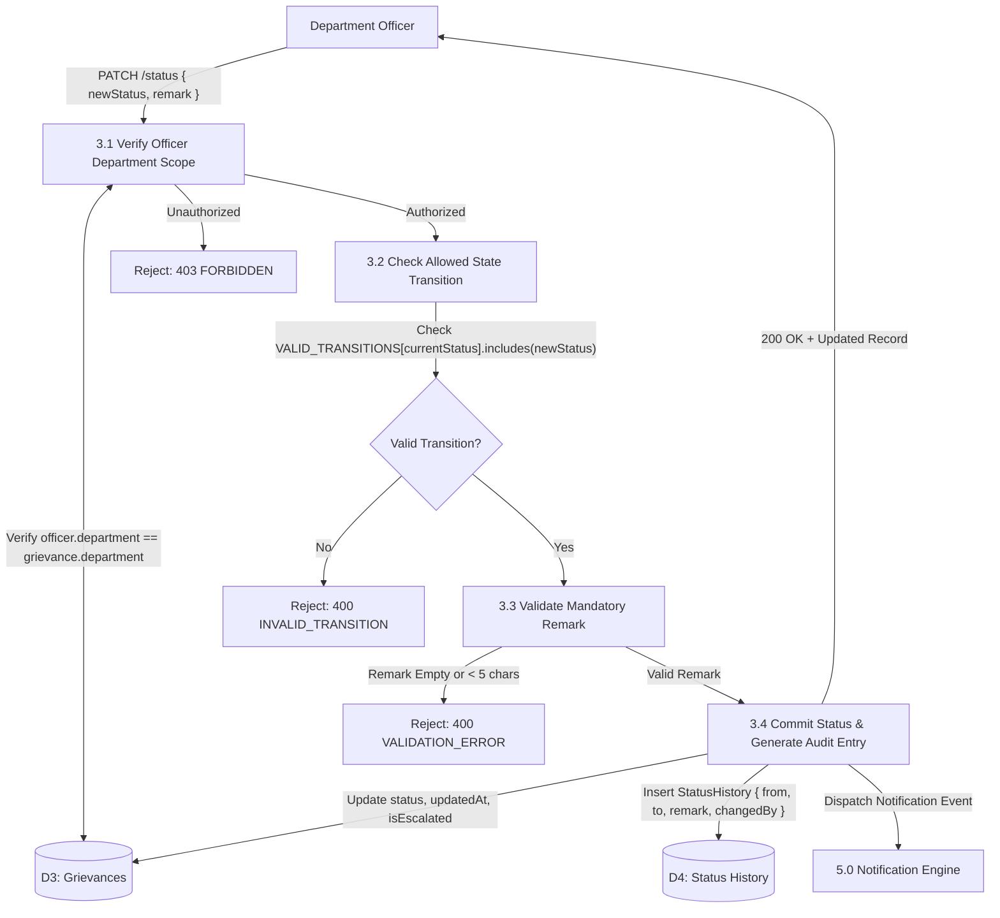
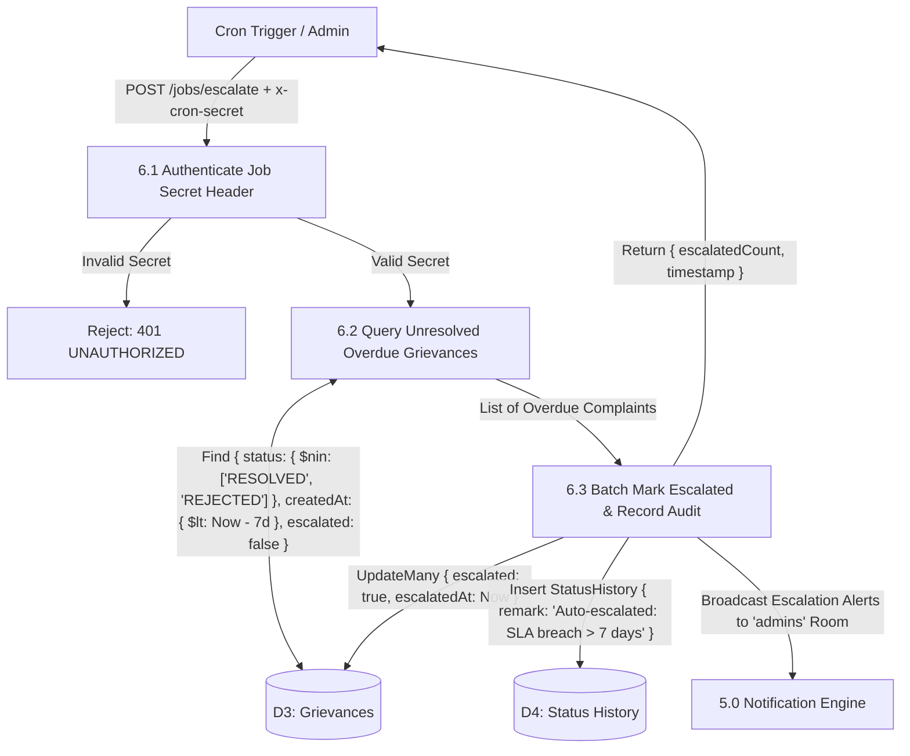

# Data Flow Diagrams (DFD) Specification
### Public Grievance Redressal and Tracking System

This document contains the Data Flow Diagrams (DFD) across all architectural levels: **Level 0 (Context Diagram)**, **Level 1 (System Decomposition)**, and **Level 2 (Detailed Process Explosions)**.

Rendered using standard Mermaid notation. You can view these directly in GitHub/Markdown readers or export them via [mermaid.live](https://mermaid.live).

---

## 1. DFD Level 0 — Context Diagram

The Context Diagram defines the system boundary, external entities interacting with the application, and the primary high-level data inflows and outflows.

---

## 2. DFD Level 1 — System Decomposition Diagram

Breaks down the central process into the 6 major functional subsystems and details interactions with the primary database stores (**D1 through D7**).

```mermaid
flowchart TB
    %% External Entities
    E1["Citizen"]
    E2["Officer"]
    E3["Admin"]
    E4["Cron Scheduler"]

    %% Level 1 Processes
    P1(("1.0<br/>Authentication<br/>& Access Control"))
    P2(("2.0<br/>Grievance<br/>Lodgment & Routing"))
    P3(("3.0<br/>Officer Triage &<br/>Workflow Update"))
    P4(("4.0<br/>Tracking, Timeline<br/>& Feedback"))
    P5(("5.0<br/>Real-Time Socket<br/>Notification Engine"))
    P6(("6.0<br/>Administration,<br/>Analytics & Escalation"))

    %% Data Stores
    D1[("D1: Users")]
    D2[("D2: Departments")]
    D3[("D3: Grievances")]
    D4[("D4: Status History (Audit)")]
    D5[("D5: Comments & Notes")]
    D6[("D6: Notifications")]
    D7[("D7: Counters")]

    %% Process 1.0 (Auth)
    E1 -->|"Register / Login Credentials"| P1
    E2 -->|"Officer Login"| P1
    E3 -->|"Admin Login"| P1
    P1 <-->|"Verify & Hash Password / Load Role"| D1
    P1 -->|"Issue Signed JWT & Session Data"| E1
    P1 -->|"Issue Signed JWT & Session Data"| E2
    P1 -->|"Issue Signed JWT & Session Data"| E3

    %% Process 2.0 (Filing & Routing)
    E1 -->|"Grievance Form + Files"| P2
    P2 <-->|"Fetch Next Seq No."| D7
    P2 <-->|"Lookup Category Match"| D2
    P2 -->|"Write New Grievance Document"| D3
    P2 -->|"Record Initial 'SUBMITTED' Log"| D4
    P2 -->|"Return Generated Tracking ID"| E1
    P2 -->|"Trigger New Complaint Alert"| P5

    %% Process 3.0 (Officer Triage)
    E2 -->|"Status Transition + Mandatory Remark"| P3
    E2 -->|"Add Public/Internal Comment"| P3
    P3 <-->|"Validate Allowed Transition & State"| D3
    P3 -->|"Update Status & Timestamp"| D3
    P3 -->|"Record Audit Entry"| D4
    P3 -->|"Store Comment Record"| D5
    P3 -->|"Trigger Status Notification Event"| P5
    P3 <-->|"Fetch Attachments & Complaint List"| D3
    P3 -->|"Display Filtered Department Queue"| E2

    %% Process 4.0 (Tracking & Feedback)
    E1 -->|"Lookup Tracking ID"| P4
    E1 -->|"Submit 1-5 Star Rating"| P4
    E1 -->|"Submit Reopen Request"| P4
    P4 <-->|"Fetch Case & Status Timeline"| D3
    P4 <-->|"Fetch Audit Trail"| D4
    P4 <-->|"Fetch Public Comments"| D5
    P4 -->|"Store Rating & Reopened State"| D3
    P4 -->|"Render Timeline & Details"| E1
    P4 -->|"Trigger Reopen Alert"| P5

    %% Process 5.0 (Notifications)
    P5 -->|"Save Notification History"| D6
    P5 -->|"Push Live Toast Event via WebSocket"| E1
    P5 -->|"Push Escalation Alert to Admins"| E3
    E1 <-->|"Fetch Unread & Mark Read"| D6

    %% Process 6.0 (Admin, Analytics & Escalation)
    E3 -->|"Create/Edit Department & Categories"| P6
    E3 -->|"Provision / Activate Officers"| P6
    E3 -->|"Reassign Complaint Dept / Officer"| P6
    E4 -->|"Trigger Auto-Escalation Check"| P6
    P6 <-->|"CRUD Department Taxonomy"| D2
    P6 <-->|"CRUD Officers & Staff Accounts"| D1
    P6 <-->|"Reassign & Mark Escalated"| D3
    P6 -->|"Log Reassignment to Audit"| D4
    P6 <-->|"Aggregate Metrics (Category / Turnaround)"| D3
    P6 -->|"Display Executive Dashboard"| E3
    P6 -->|"Trigger Escalation Broadcast"| P5
```

---

## 3. DFD Level 2 — Detailed Process Explosions

### 3.1 DFD Level 2 for Process 2.0 (Grievance Lodgment & Routing)
Explodes how incoming complaints are validated, sequentially numbered, categorized, and stored.

---

### 3.2 DFD Level 2 for Process 3.0 (Officer Workflow & State Machine)
Explodes how an officer's action is vetted against state machine rules, audited, and logged.

---

### 3.3 DFD Level 2 for Process 6.0 (SLA Monitoring & Escalation)
Explodes how automated cron timers or manual admin triggers detect overdue grievances.

