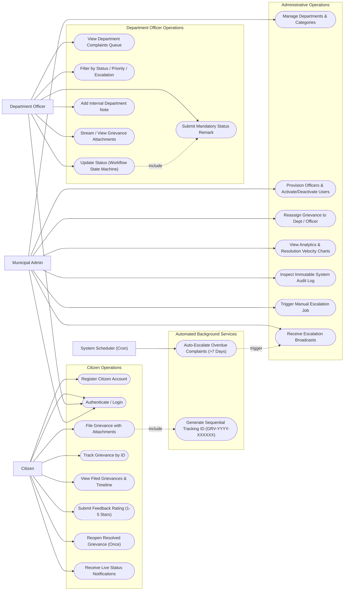
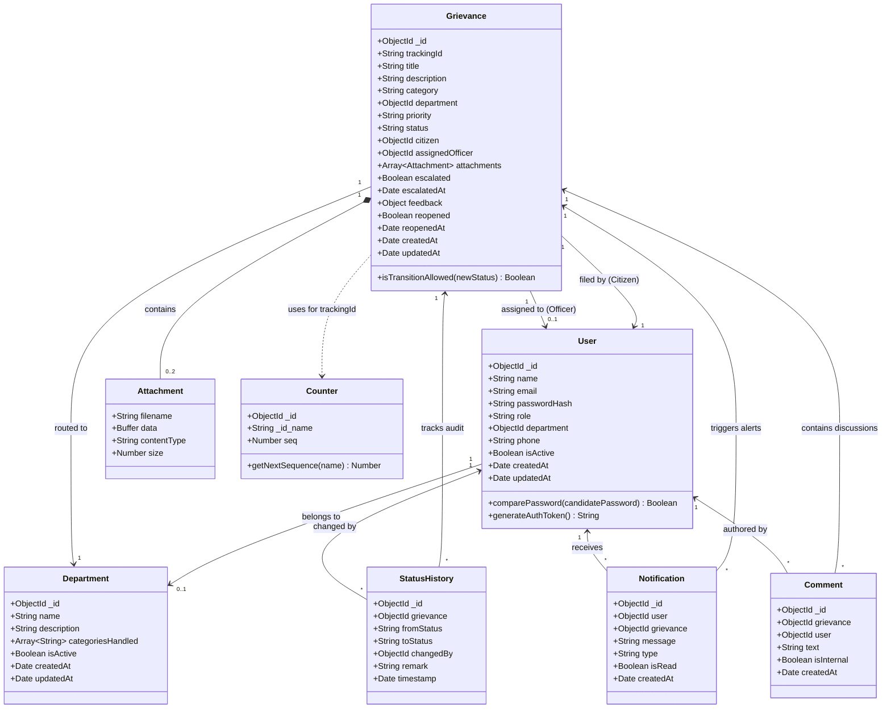
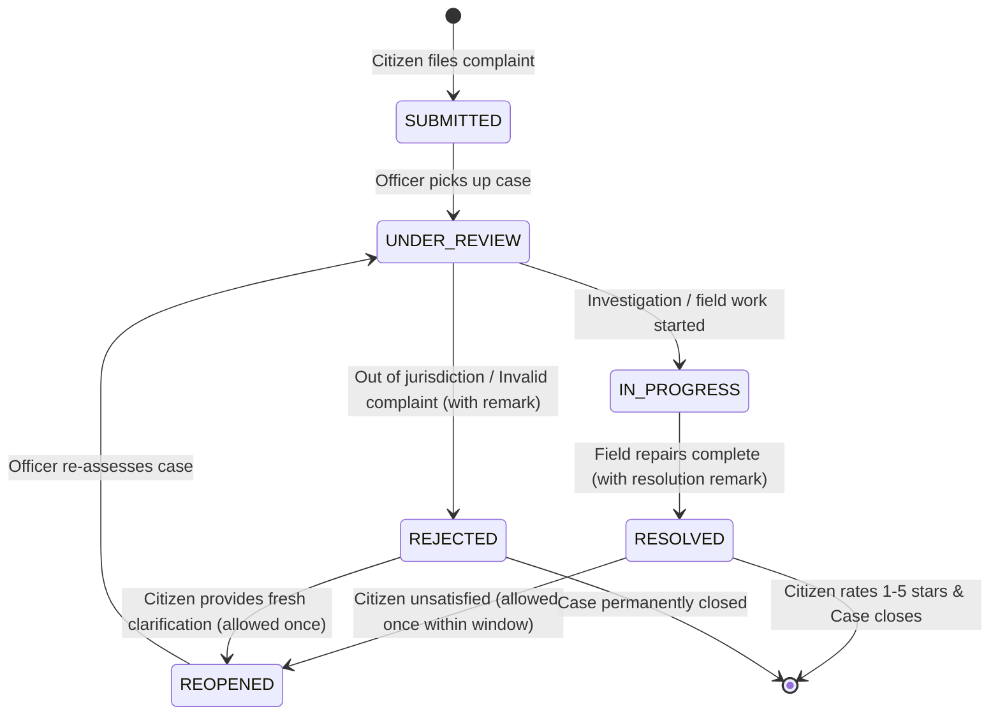
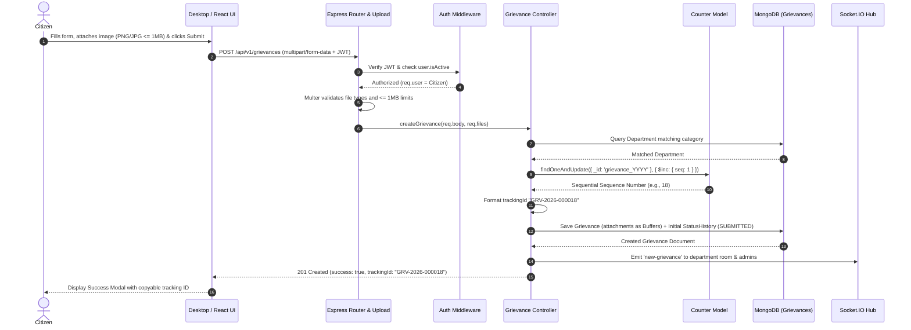
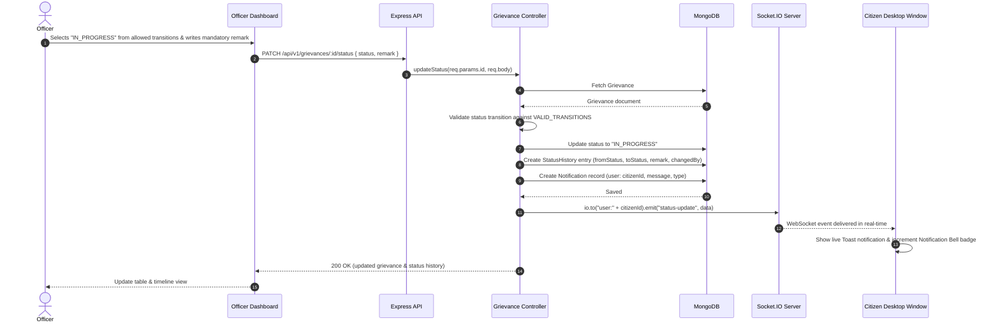
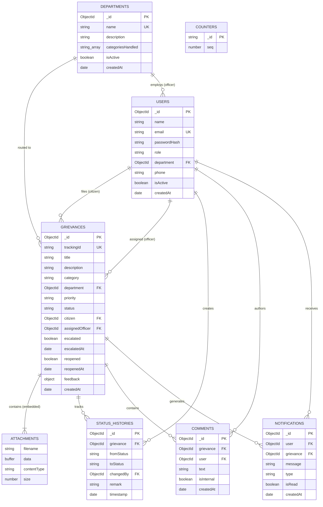

# UML Diagrams Specification
### Public Grievance Redressal and Tracking System

This document contains the complete collection of Unified Modeling Language (UML) diagrams for the system, rendered using Mermaid. You can view these directly in GitHub, Markdown viewers with Mermaid support, or paste the code blocks into [mermaid.live](https://mermaid.live) to export high-resolution PNG/SVG assets.

---

## 1. Use Case Diagram

Visualizes the interactions between the system actors (**Citizen**, **Officer**, **Admin**, and **System Cron**) and system use cases.

---

## 2. Class Diagram

Defines the structure of the domain models, attributes, methods, and relationships implemented in MongoDB via Mongoose.

---

## 3. State Machine Diagram (Grievance Lifecycle)

Depicts all legitimate status states and transition guards defined in `VALID_TRANSITIONS`.

---

## 4. Sequence Diagram: Filing a Grievance

Shows the end-to-end execution flow when a citizen files a new complaint with file attachments.

---

## 5. Sequence Diagram: Officer Status Update & Live Notification

Shows how an officer updates a status, writes to the audit log, and broadcasts a real-time event.

---

## 6. Entity-Relationship (ER) Diagram

Represents the physical relational schema and database foreign key references.

